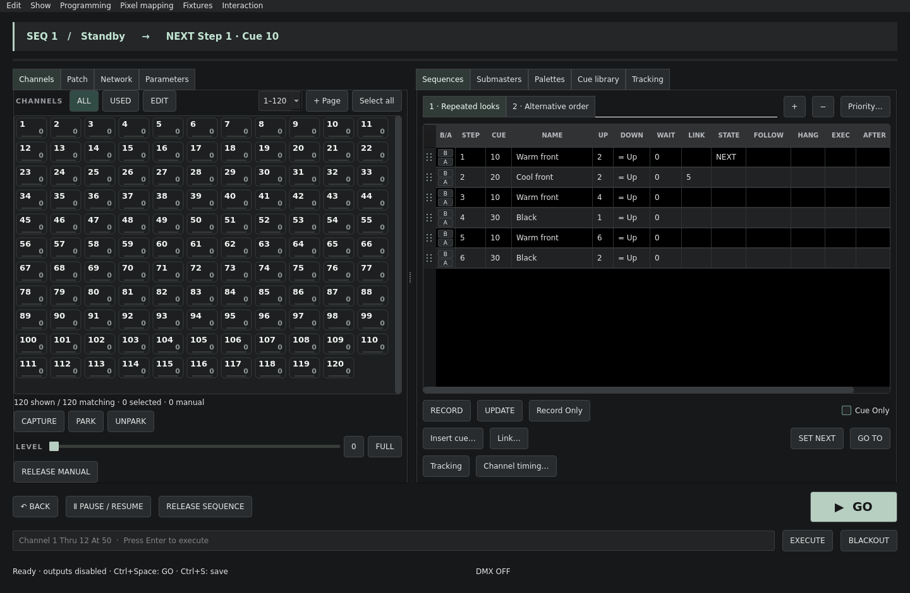
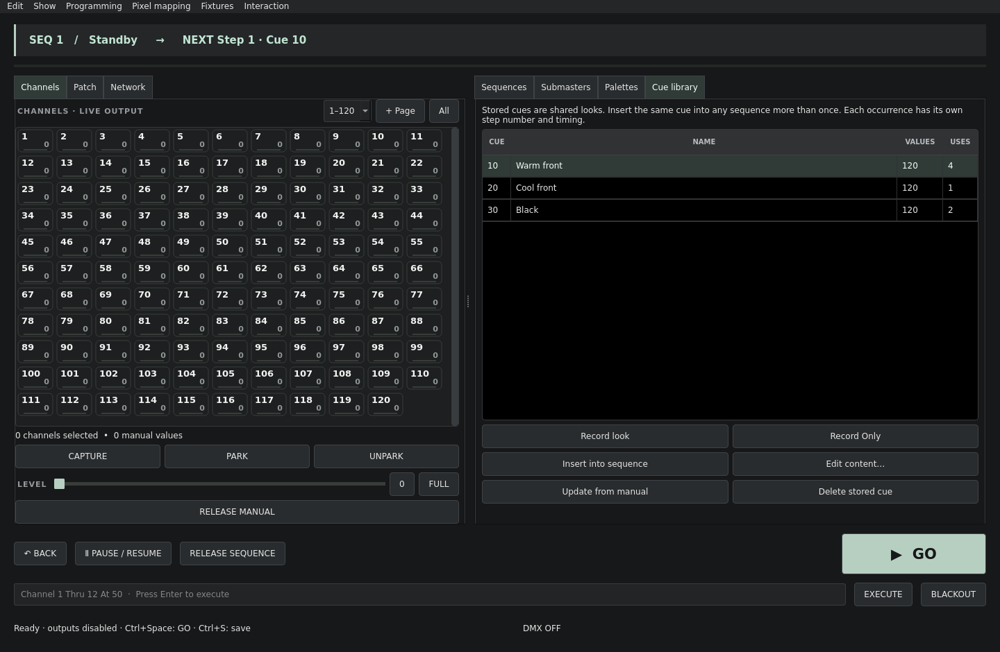
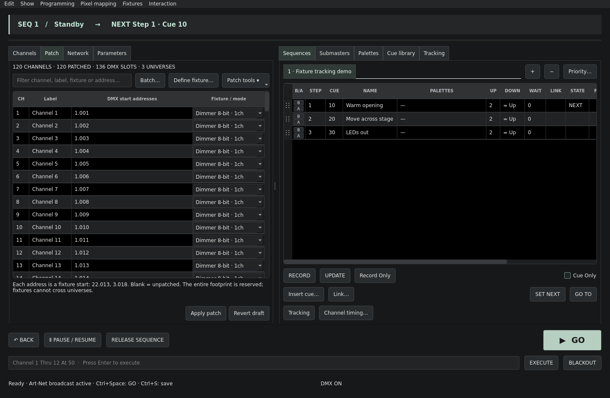
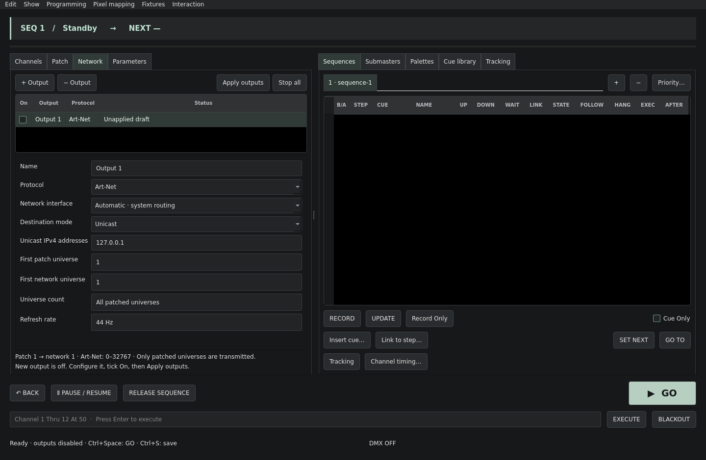
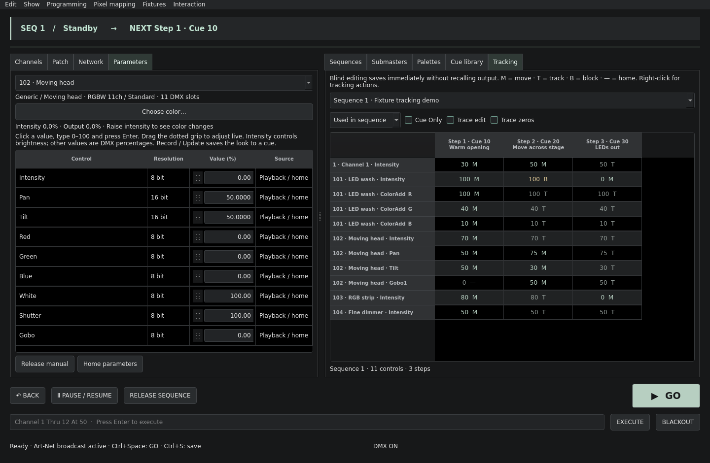
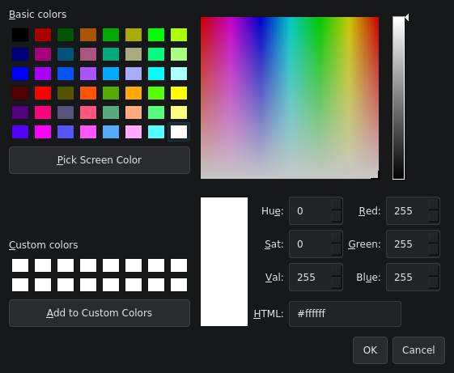
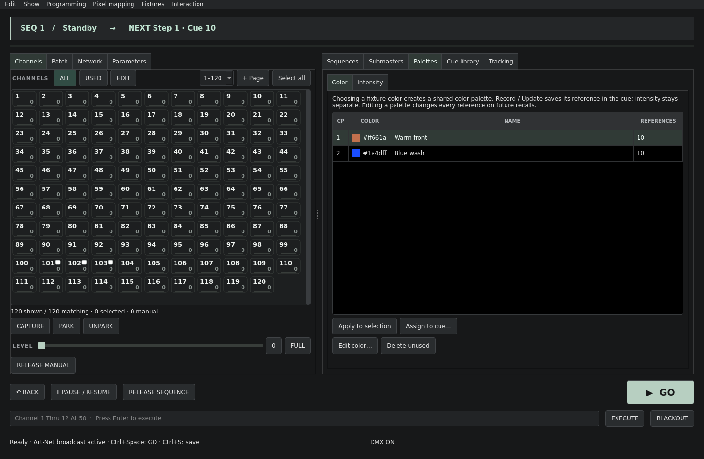

# Cold Flame

Desktop lighting console written in C++17 / Qt 6 for macOS, Windows and Linux.
**Development version 0.10.0: full Eos coverage is a goal, not an existing capability.**











## Downloads and automated releases

Each published GitHub release triggers native application builds for a universal macOS app for Apple Silicon and Intel, Linux x86_64, and Windows x86_64. Downloads include bundled Qt libraries, native platform plugins and SHA-256 checksums. Windows includes an installer `.exe` and portable ZIP; macOS includes `.app` ZIPs and DMGs; Linux includes a runnable archive. See [release instructions and signing status](docs/RELEASING.md).

## macOS: install, build and launch

From Terminal, in the repository root:

```sh
./build.sh
```

The script installs Homebrew if absent (its installer may request your macOS password), then installs missing Qt 6, CMake, Ninja and zlib packages, builds a Release `.app`, and opens it. Existing Homebrew packages are reused. You can use `./build.sh --no-run` to build without launching, or `./build.sh -- "$PWD/examples/theatre.cfl"` to launch the sample show. The default build directory is `build-macos`; use `--build-dir PATH` to override it. `--no-deps` skips package installation when dependencies are already available.

## Build and test

Requirements: CMake 3.21+, a C++17 compiler, Qt 6.2+ (Core, Widgets, Network, Test), and zlib.

```sh
cmake -S . -B build -DCMAKE_BUILD_TYPE=Release
cmake --build build --config Release --parallel
ctest --test-dir build -C Release --output-on-failure
```

Run `build/cold-flame` (Windows multi-configuration: `build/Release/cold-flame.exe`).
Native release packaging is enabled with `-DCOLD_FLAME_DEPLOY=ON`; it deploys the required Qt runtime and plugins. CI builds and tests all target operating systems; a configured job is not evidence of success until it has run.

## Your first show

1. A new show contains 120 dimmer channels patched to addresses 1–120. The live **Channels** tab shows numbers, levels and state marks (P for Park, C for Capture, a warm dot for manual), without patch addresses. Use the range selector for pages of 120; **+ Page** adds the next 120 channels, assigning unused DMX addresses. Selection can span pages. **Patch** is the adjacent tab with one wide spreadsheet. Edit labels and comma-separated DMX destinations; conflicts block Apply. Revert draft discards edits. Full view opens a larger patch editor.
2. Select channels with the mouse (Ctrl / Shift for multiple selections), or type `Channel 1 Thru 12 At 50` and press Enter.
3. Click **Record** to store a reusable look in the **Cue library**, without inserting it into a sequence. Cues receive numbers 10, 20, 30… and names cue-10, cue-20…. Record stores the full unmastered look, excludes Park, and preserves manual palette references. **Record Only** stores manual controls; touched RGB fixtures include intensity and current color. Rename and renumber stored cues in the library.
4. Select a library cue and **Insert into sequence** to append it to the selected sequence. Alternatively, **Insert cue…** in the sequence inserts before the selected step. A stored cue may appear several times, and in several sequences. **STEP** identifies the occurrence; **CUE** identifies its shared content. Step IDs start at 1 and stay unchanged when reordered by dragging the dotted grip at the left of a row. The insertion line shows where it will land; the sheet scrolls when dragging near its edges. Right-click a row and choose **Remove step** (or press Delete while the sheet has focus) to remove the occurrence, keeping its stored cue.
5. Edit Up / Down / Wait directly in the step sheet. There is no separate time field below the sequence. Each occurrence retains its own timing and triggers. Follow, Hang, Execute and After have dedicated editable columns. Default transfer time is 2 seconds. Select a step and **Set Next** to queue it without changing output; **Go To** plays it immediately. `Ctrl+Space` triggers Go; `Ctrl+S` saves.
6. **Link…** selects the exact occurrence, including its sequence, step ID, cue and name. For example, steps 1, 3 and 7 can all use cue 10; linking to step 7 always chooses that occurrence, even after reordering. Link queues the target; Follow / Hang can fire it automatically. The Link cell accepts a step ID or `sequence/step`.
7. Use **+ / −** above the step sheet to create or delete sequences (1, 2, 3…). One must remain. Double-click a sequence tab to rename it. Drag the workspace tabs to arrange them. Each sequence retains its own state and fade. Higher priority wins; at equal priority, the most recently triggered move wins for the channels it owns.
8. **Edit content…** in the cue library edits the shared cue. **Update from manual** merges manual values; all referencing steps use the new look on their next playback, without changing active fades. A referenced library cue cannot be deleted until its occurrences are removed. **Update** on a sequence step updates its shared cue, unless Cue Only is enabled, which creates local step overrides. Existing local overrides remain local.
9. Save as `.cfl`. Format 5 contains submaster mode and bump timing, and color palette definitions/references as well as the fixture profiles/assignments, parameter data, cue library, steps, tracking overrides, patch, palettes, groups, submasters and network settings. Format 1–4 shows still load; saving writes format 5. Older Cold Flame builds cannot open format 5. Opening another show from the File menu disables outputs. At application startup, an Art-Net broadcast route is activated after loading the initial show.

The reusable-look model follows [Congo/Cobalt’s documented preset-and-sequence model](https://support.etcconnect.com/ETC/Consoles/Congo_Cobalt/Software_and_Programming/Preset_vs_Cue_in_Congo). Eos uses cue numbers within cue lists; its [Link](https://www.etcconnect.com/WebDocs/Controls/EosFamilyOnlineHelp/en/Content/12_Cues_and_Cue_Lists/04_Cue_Attributes/Link_Loop.htm) addresses such cues. Cold Flame explicitly addresses sequence steps to distinguish repeated stored cues.

Commands include `Record Cue 10` (store only), `Record Only Cue 20`, `Update Cue 10` (merge manual data), `Insert Cue 10` (append an occurrence), `Step 1/3` (select without firing), `Go To Step 1/3`, `Sequence 1`, `Go`, `Back`, `Pause` and `Resume`. `Cue 10` and `Go To Cue 10` work only when the cue identifies a single occurrence in the current sequence; repeated occurrences require a Step target. Explicit `Record Cue 1/30` / `Update Cue 1/30` retain the legacy inline step-editing syntax. Channel selection supports `1 Thru 12 + 20 - 5 At 50` and relative `At +10` / `At -10`. The virtual keypad is under **Programming**; configurable hardware integration is not yet implemented.

The channel toolbar has three mutually exclusive views:

- **ALL** shows all patched channels in their numbered pages of 120.
- **USED** shows only channels with live output above zero, including manual control, fades, cues, submasters and Park. It follows live changes and searches across every channel page.
- **EDIT** shows channels stored in the selected sequence step, including its shared cue, local overrides and blocked data. When the Cue Library tab is active, it follows the selected stored cue instead. Stored zero levels are included. Nothing is shown if no step or cue is selected.

Filtered results are compacted into pages of up to 120 matches. View changes preserve channel selections, including hidden channels. **Select all** selects the currently displayed channels. These views only change visibility; they never alter output, patching or cue data.

Buttons show immediate contextual help at the bottom right, without floating tooltips. Numeric spin fields use [NyxMap’s horizontal drag interaction](https://github.com/PixelStereo/NyxMap/blob/main/src/ui/Widgets.cpp): drag without focusing to change the value; Shift is fine, Ctrl / Command is coarse, and a click selects the number for typing. Once editing, ordinary text selection works. The adapted code’s [MIT notice](licenses/NyxMap-MIT.txt) is included in application packages.

## Core editing and manual control

- **Record Only** stores manual values in a reusable cue, with intensity and color paired for touched RGB fixtures. **Cue Only** makes sequence Update and Blind edits local to that occurrence, preserving the next step where tracking would otherwise propagate the change.
- **Tracking** is a workspace tab for channel and fixture-parameter values across sequence steps. M/T/B indicate moves, tracks and blocks. Edit locally in Blind, clear or right-click to track from the previous step, apply a channel/parameter Block, find its source, or use Trace edit (including Cue Only and forced tracing through zeros). See the [fixture and tracking guide](docs/FIXTURES-AND-TRACKING.md).
- The stacked **B / A** buttons at the left of each step toggle Block and Assert. Block protects tracked values against upstream edits; Assert takes back tracked intensity when the step plays.
- **Capture** toggles manual protection on selected channels. Playback and submasters cannot override captured channels; manual level changes still work. Release manual leaves captured values alone.
- **Park** locks selected channel outputs; **Unpark** restores normal output. As in Eos, Park overrides grand master and blackout and is excluded from recordings. The tile displays P. These are temporary channel parks; address parks, scaling and park persistence are not implemented.
- **Edit → Undo/Redo show edit** restores up to 100 stored-definition states, including cue, palette, group and patch edits. It preserves running transport and manual levels. This is not Eos's complete selective Undo system and does not undo Go, live manual changes or hardware effects.

Equivalent selection commands include `Select Active`, `Select Manual`, `Capture`, `Park`, `Unpark`, `Home`, `Release`, `Block` and `Assert` (the last two use the selected cue).

## Multiple DMX destinations per channel

In Patch, the **DMX start addresses** cell accepts comma-separated `universe.address` destinations. For example, channel 12 can have:

```text
22.013, 3.018, 3.512
```

For an 8-bit dimmer, all three destinations receive the same channel level, fades and blackout. For a multi-parameter fixture, each address starts a complete copy of its fixture footprint. Multiple targets are saved with the show; old single-address show files still load. Duplicate DMX addresses are rejected. Universe numbers in the patch are relative to the configured first output universe: with first universe 1, the example sends to sACN universes 22 and 3; with Art-Net first universe 0, their wire universe numbers are 21 and 2. Set the first Art-Net universe to 1 if you want the displayed universe numbers to match its wire numbers.

## Cue timing and submasters

The step sheet shows Up, Down, Wait and Link Step. Times are in seconds.

- **Up** is the common transfer time. **Down** defaults to `= Up`; enter a number to split rising and falling fades. Clear Down to restore the shared time.
- **Wait** delays the start of the transition; it does not automatically trigger another cue.
- **Link Step** changes the pending occurrence. It does not fire automatically without Follow or Hang. It accepts a step ID or `sequence/step`; the picker identifies the exact repeated cue occurrence.
- The **Follow** and **Hang** columns expose **Follow** (seconds from cue start) and **Hang** (seconds after cue completion, including negative values for overlap). They are mutually exclusive: entering one clears the other. Clear a cell to remove its trigger. They automatically fire the pending step, honoring Link.
- **Execute** fires one target step when the source starts. Another sequence runs independently; executing within the same sequence jumps that sequence.
- **After cue** is a separate Cold Flame extension: fire a side playback when the step finishes, keeping the main next step unchanged. It uses one side-playback slot per originating sequence and does not chain triggers from the side cue. It must not be confused with Eos Link.
- Automatic zero-time chains are bounded to prevent a looping show from blocking the application. Configurable Eos loop counts and Go After Loop are not implemented.
- **Channel timing** applies separate up/down/wait times to the selected channels in the selected step. Use **Use step timing** to remove overrides. Row help shows the number of individual timing overrides; the count columns are hidden to leave space for editable triggers.
- The **Submasters** tab contains a card bank, numbered 1, 2, 3… Each card has a fader, Out, Full, Edit, Update and Delete. **Edit** changes the name, channel membership and stored intensities; Save commits the edit. **Update** replaces the contents with selected live channels (all if none are selected), excluding that submaster’s own contribution. Manual values have precedence; use Release Manual below the channel grid to hear the submaster. Definitions are saved; faders reset to zero on load. Deleting a running submaster removes its contribution immediately; Edit → Undo restores its definition.

A format-2 example, `examples/repeated-cues.cfl`, uses cue 10 at three different steps and in two sequences, with a link to a specific occurrence.

The original inline example is included: `build/cold-flame examples/theatre.cfl`. It contains four lighting looks, two palettes and two submasters.

## Networking and interaction

**One Art-Net broadcast output is enabled at startup**, including when launching with a show file. An existing Art-Net broadcast route is reused; otherwise a default route is added (44 Hz, patch universe 1 → Art-Net universe 1, all patched universes, automatic interface). Other saved routes stay off. Art-Net uses broadcast, not multicast; multicast is available for sACN. **Network** opens the tab next to **Channels** and **Patch**, inspired by the [NyxMap output panel](https://github.com/PixelStereo/NyxMap/blob/main/src/ui/DmxOutputsPanel.cpp). Add independent outputs with **+ Output**, configure them, tick **On**, and choose **Apply outputs**. Changes stay in a draft until applied. **Stop all** immediately disables every route and terminates active sACN streams.

Each output has a name, Art-Net/sACN protocol, local IPv4 interface (or automatic system routing), Unicast with one or more addresses, Art-Net Broadcast or sACN Multicast, 1–44 Hz rate, and sACN priority/source name. The table shows packet counts and send errors. UDP send success does not confirm reception by a fixture.

Routing maps **First patch universe** to **First network universe**, preserving offsets. **Universe count** limits the range; 0 means all patched universes from the first patch universe. Only patched universes are sent. For example, patch universe 3 can map to sACN universe 22 on one output and Art-Net universe 7 on another. Multiple outputs may run together. Configuration is saved with the show. Opening another show resets On switches; at application startup one broadcast route is activated as described above. Applied route settings are outside the show-definition Undo history. Reapplying restarts routes and their packet counters.

Art-Net universe numbering is zero-based; sACN accepts 1–63999. Patch addresses are 1-based and split into blocks of 512. Target refresh rate: approximately 43.5 Hz. Fades, UI updates and output currently share the Qt event loop; separate engine/output threads remain to be implemented.

Enable OSC under **Interaction**, bound to `127.0.0.1:9000`. Supported messages use a single float argument:

- `/coldflame/sequence/1/go` with a positive value: Go.
- `/coldflame/master` from 0 to 1: grand master.
- `/coldflame/blackout`: positive enables blackout; zero disables it.

OSC bundles, feedback and configurable remote reception are not yet supported.

**Pixel mapping** provides a sinusoidal intensity wave across selected channels in ascending numerical order, with adjustable speed and spread. Its layer overrides sequences and is overridden by manual values. This is an initial 1D generator; RGB matrices, video layers, masks and GPU processing remain to be developed.

**Patch tools** imports/exports GDTF and transfers applied patches as `.cfp` files. Built-in 8/16-bit dimmers, RGB/RGBW and moving-head profiles are available. Supported GDTF modes patch 8/16/24/32-bit parameters with defaults, byte ordering and Snap, and record/play them through cues. Whole-footprint overlap and universe-boundary validation applies to every fixture start address. **Parameters** provides live controls. Geometry expansion, multiple breaks, mode dependencies, physical-unit tools, MVR and fixture-type migration remain incomplete; unsupported modes are rejected. See the [supported formats and programming guide](docs/FIXTURES-AND-TRACKING.md).

## Status and next steps

See the [Eos behavior audit](docs/EOS-COMPATIBILITY.md), [feature matrix](docs/FEATURES.md) and [hardware surface proposal](docs/HARDWARE.md). This alpha is intended for preparation and experimentation. It has not yet been validated against a physical lighting rig, through endurance testing, or during a live show.

The interface palette follows [DMXPulse](https://github.com/PixelStereo/DMXPulse/blob/main/src/window.cpp): charcoal surfaces, neutral text, sage accents and warm state indicators. Channel tiles use compact numeric information; patch details remain in their own tab.

`examples/fixtures-and-tracking.cfl` demonstrates generic fixtures, sparse shared cues, tracked parameters and a channel block. See the [fixture and tracking guide](docs/FIXTURES-AND-TRACKING.md).

Color-capable channels have a clickable swatch. Click the swatch, double-click the tile, or right-click → **Choose color…** for live RGB/RGBW/CMY selection. Cancel restores previous manual color values; intensity is unchanged. Record/Update stores the color parameters normally.



Color palettes are stored independently and referenced by cues. RGB recordings include intensity and color; default white is an invisible, immutable reference. Confirming a fixture color creates or reuses a palette. **Palettes → Color → Assign to cue…** assigns it directly to a stored cue, retaining intensity. Right-clicking a cue offers the same action. **Edit color…** changes the shared palette; Cue Only creates local step overrides. See [palette types and references](docs/PALETTES.md).

`examples/color-palettes.cfl` demonstrates shared Color Palettes, repeated cue occurrences and hidden default white.



Submasters now support additive HTP or inhibitive intensity, with timed bump controls (Up / Dwell / Down; Manual, Hold or Timed). See [Submaster operation](docs/SUBMASTERS.md).

Create custom fixture definitions from **Patch → Define fixture…**. The editor supports multiple modes, attributes, byte offsets, raw DMX home values and Snap. **Unpatch conflicting outputs…** previews how to free occupied slots for a new patch. See [fixture definitions](docs/FIXTURE-EDITOR.md).
