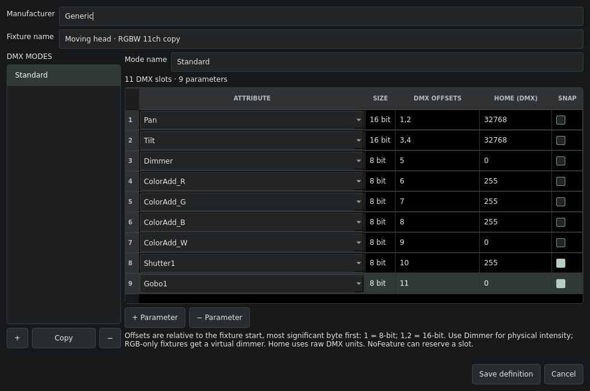

# Fixture definitions

Open **Patch → Define fixture…** or **Fixtures → Define fixture…** to create a definition in this show's patch draft. Start with a Dimmer, enter manufacturer and fixture name, then define its DMX modes. Try [`examples/custom-fixture.cfl`](../examples/custom-fixture.cfl) for a spot with 11-slot and RGB modes.

## Parameters and modes

The mode list provides **+**, **Copy** and **−**. Each mode has its own name and parameter table. A fixture must retain at least one valid mode; names must be distinct. Invalid data is highlighted in the message below the table and prevents saving.

- **Attribute**: choose a standard GDTF attribute or type its identifier. `Dimmer` is physical intensity. A mode can contain one physical dimmer; RGB modes without one use a virtual intensity control. Familiar attributes include Pan, Tilt, RGB/RGBW, CMY, Gobo1, Zoom, Iris and Shutter1.
- **DMX offsets**: relative slots starting at 1, listed most significant byte first. `1` is 8-bit; `1,2` is 16-bit; three or four offsets provide 24/32-bit control. Nonconsecutive or reversed byte orders are supported. Offsets cannot overlap or exceed 512.
- **Home (DMX)**: the raw unsigned default, from 0 to 255 for 8-bit, 65535 for 16-bit, or the corresponding 24/32-bit maximum. For example, Pan with offsets `2,3` and Home `32768` starts around the midpoint. RGB home behavior still follows the requested hidden-white policy.
- **Snap**: jump to this parameter's target instead of fading it.

Footprint is calculated from the last defined offset, including gaps. Add a `NoFeature` parameter to reserve a trailing slot; its Home normally stays zero. Definition edits do not send DMX by themselves.

## Save, copy and patch

**Save definition** stores the result in the patch draft and selects it for Batch. Choose it in a channel's Fixture / mode cell or use Batch, then **Apply patch**. Cancel leaves the definition unchanged; **Revert draft** discards unapplied work.

**Patch tools → Edit / copy selected fixture…** opens the definition for the selected patch row. Built-ins, imported GDTF profiles and profiles assigned in the active show are copied to a new profile ID. The original remains available. Unused native definitions can be edited in place. This policy protects the parameter keys stored by cues, palettes and playback; it does not implement fixture migration. A fixture with stored/live non-intensity data still cannot be changed to another profile or mode.

Native definitions are stored in `.cfl` shows and `.cfp` patch transfers. Export the selected patched definition with **Patch tools → Export selected fixture as GDTF…**. Imported vendor archives remain unchanged on export. Native export validates modes and refuses footprints that cannot survive a GDTF round trip.

## Resolve occupied DMX slots

After entering a start address, selecting a larger mode or using Batch, overlaps reveal **Unpatch conflicting outputs…**. The preview lists the affected channels, starts to remove and copies to retain. Confirming gives the newly entered patch priority in the draft; **Apply patch** makes it live. Cancel preserves the draft. The entire conflicting fixture copy is unpatched, including fine bytes and gaps, while its logical channel and stored cue data remain.

Overlaps among the new fixture's own copies, or a footprint crossing a universe boundary, must be corrected directly. The resolver does not choose an arbitrary winner between conflicting new fixtures.

## Reference and limits

The workflow is informed by ETC's [Creating Fixtures in the Editor](https://www.etcconnect.com/WebDocs/Controls/EosFamilyOnlineHelp/en/Content/06_Patch/06_Fixture_Editor/Creating_Fixtures_in_the_Editor/CREATING_FIXTURES_IN_THE_EDITOR.htm). Cold Flame uses its supported GDTF data model, rather than Eos's full fixture engine.

Home and playback use normalized DMX values internally. Physical units, function/range tables, wheel-slot definitions, lamp-control macros, calibration, multicell geometry, relations, mode masters, multiple breaks and automatic fixture migration remain incomplete. Profiles with unsupported modes must be defined as supported direct modes before they can be edited here. Generated archives are tested with Cold Flame's importer; validation in grandMA3 and against physical fixtures remains outstanding.
