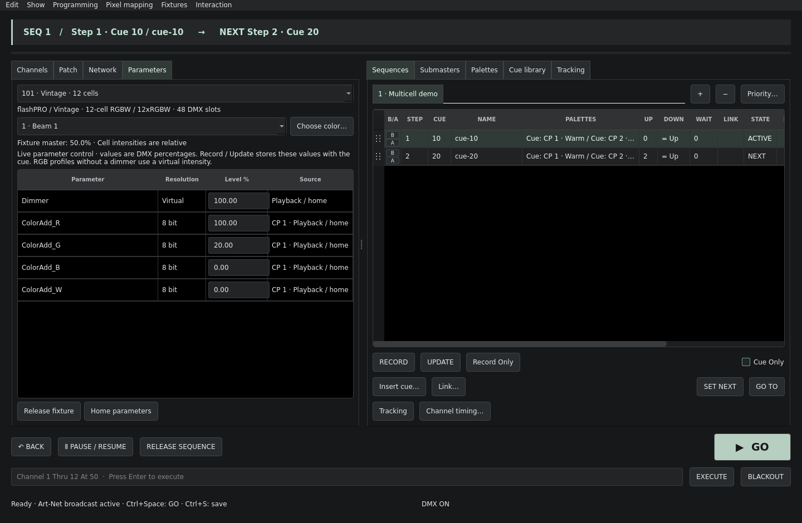

# GDTF geometry references and multicell fixtures

Geometry references are expanded into independent parameter controls using their Break offsets. Nested offsets add; invalid targets, cycles, duplicate cell paths, internal address collisions and universe crossings are rejected. Unused templates outside the selected mode's geometry tree do not add DMX slots. Direct geometry groups with multiple intensities or repeated color emitters can also become cells.

The fixture keeps one whole-number console channel and one DMX footprint. Each cell has a stable geometry-instance path, with its own relative intensity, color and parameter data. The footprint reserves gaps and fine bytes as well as coarse slots. Imported GDTF archives are still re-exported unchanged.



## Operate a fixture

1. Import the GDTF from Patch tools and select a supported mode. Apply the patch.
2. Use the channel intensity for the whole fixture. Fixture masters start at Out. Cell intensities default to Full relative to that master, following the [Eos multicell intensity model](https://www.etcconnect.com/webdocs/Controls/EosFamilyOnlineHelp/en/Content/08_Manual_Control/Multicell_Fixtures.htm).
3. Open **Parameters**. Its selector provides **Master + all cells**, **Master only**, and numbered cells/groups. Edit a cell intensity or its other controls there.
4. **Choose color…** operates on the selected scope. Preview is live; Cancel restores that scope's previous values and references. The channel-grid picker applies to all color-capable cells; its swatch represents the first color-capable group.
5. Record and Update as usual. Cues store cell values and Color Palette references. Tracking, local step overrides and individual parameter times use those same controls.

Basic decimal intensity commands are supported:

```
101 At 50          # fixture master
101.2 At 25       # displayed cell/group 2, relative to the master
101.0 At Full     # master only
```

Enter commands without the explanatory comments. Cell numbers match the Parameters selector. Full Eos cell-range, cell-selection and parameter-fallback grammar is not implemented. Current submasters act on the fixture master; they do not store separate cell looks.

Physical dimmers carry the master level once. A virtual cell dimmer scales additive emitters in software. Parent/group and cell dimmers retain separate relative levels; physical dimmers must not cause their color values to be scaled a second time. Cell intensity homes are Full relative weights, independently of a manufacturer's raw zero Dimmer default. Color mixing remains normalized DMX, without fixture calibration.

Try [`examples/multicell.cfl`](../examples/multicell.cfl): channel 101 has twelve RGBW cells, with alternating Warm/Blue palettes and two shared cues.

## Profiles supplied for validation

The original uploaded archives were imported and checked locally; archive re-export remains byte-for-byte identical. Reduced structural descriptions, without artwork or 3D models, provide CI regression coverage in `tests/fixtures`.

| Profile | Supported modes | Still unavailable |
|---|---|---|
| flashPRO Vintage LED Washer 12 × 30 W, SHORT Mk2, flashPRO_v1 | 22 of 30: Classic-6; Pro-6/7; RGB/RGBW and their 16-bit variants; Classic-14; 3xClassic-6; Pro-15/21; 3xRGB/RGBW and 16-bit variants; Classic-50; 12xClassic-6; Pro-51; 12xRGB/RGBW and 16-bit variants | Classic-8, M-Control-10/18/22/54/76, Flash A-DMX and 3xFlash A-DMX use conditional ModeMaster functions |
| Flash ART BarFX 800 IP65, FLASH_v3 | 13 channel, 64 channel, 89 channel | 4 channel-NET and 20 channel-NET use multiple output/source breaks |

**Profile anomaly:** the Vintage `12xRGBW 16bit` geometry offsets run `1, 17, 25, …, 97`. The file therefore declares a **104-slot** footprint, including an eight-slot gap after cell 1. Cold Flame follows those offsets instead of guessing a 96-slot layout. Verify that mode against the fixture's manual/hardware before relying on it.

## Scope and validation

Supported relations are virtual Dimmer **Multiply** relations targeting additive emitters on the same source geometry. The supported output uses break 1, including explicit Overwrite mappings. Extra mappings unused by the selected mode do not create extra outputs. Multiple physical output breaks, conditional ModeMaster functions, general relation graphs and multiplexed logical channels remain unavailable.

Expansion is bounded to 512 parameter controls per fixture, including virtual controls, with depth/instance limits and a 512-slot universe footprint. This covers the supplied pixel modes; it is not a claim of arbitrary GDTF conformance. Geometry paths provide control grouping; this change does not render 3D models or apply spatial transforms to pixel mapping.

Show format **7** stores cell identities and original OFL sources. Formats 1–6 remain readable; saving writes format 7. Existing supported single-cell control keys retain their ordering. Native definition editing exposes a Cell column and virtual intensity offsets. If an imported profile contains unsupported modes, the definition editor copies only the selected supported mode; the original profile remains intact.

Tests cover the supplied descriptions and original archives, independent cell colors/intensities, cue recall, show/native GDTF round trips, nested and Overwrite offsets, direct cells, physical/virtual master scaling, invalid references, cycles, collisions, and color Cancel. Address/undefined-behavior sanitizer checks cover the engine. Physical-fixture testing and exhaustive GDTF/Eos equivalence remain outstanding.

GDTF addressing reference: [Geometry Reference and Break definitions](https://gdtf-development.com/help/developers/gdtf_1_2/file-format-definition/index.html).
