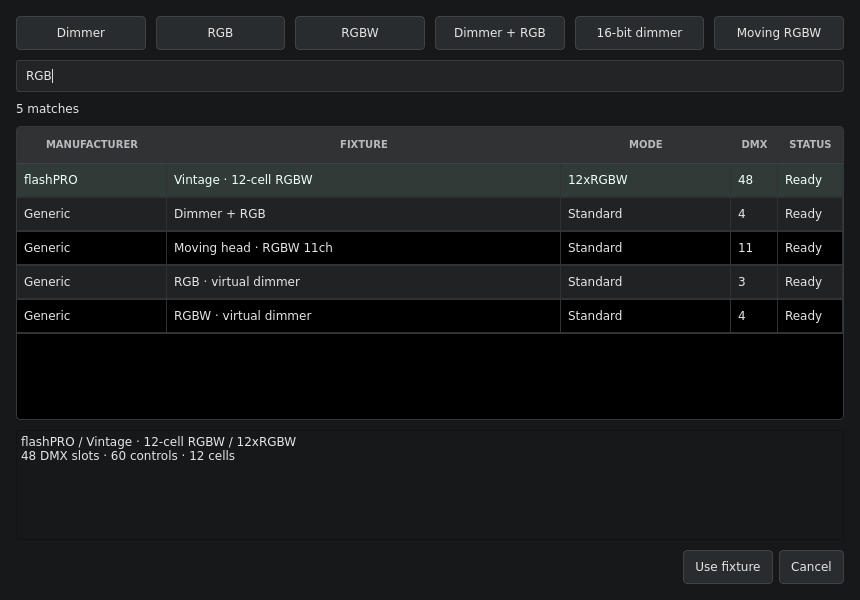

# Open Fixture Library JSON and fixture search

Cold Flame 0.12 imports the OFL 12.x fixture format from
[Open Fixture Library](https://open-fixture-library.org/). GDTF remains supported.

## Choose a fixture

Click the **Fixture / mode** field in Patch or Batch. Six quick choices cover
Dimmer, RGB, RGBW, Dimmer + RGB, 16-bit dimmer and a generic moving RGBW head.
The search field matches manufacturer, fixture and mode together, ignoring case:
`flash washer rgbw` or `tour spot 16`.

The search covers profiles imported into **this show's library**. It does not
download the online OFL catalogue. Empty search shows the quick choices and the
current custom fixture. Typing searches every mode; results are capped at 200
with the total match count and a prompt to refine the query. Each patch row keeps
only six quick choices plus its current custom selection, regardless of library
size. Library contents are shared rather than copied into every row.

Use Down to enter the results, arrows to choose a mode and Enter to confirm.
Double-click or **Use fixture** also selects it. Escape/Cancel retains the
previous assignment. The details area shows DMX footprint, control count, cells,
raw-control notes and unavailable-mode reasons. Unavailable modes can be inspected
but cannot be selected. Mouse-wheel scrolling over the closed field cannot change
a fixture. Selecting a different fixture/mode never bypasses patch validation or
the protection for stored parameter identities.

## Import and export

1. Download fixture JSON using OFL's **OFL** export, or use a repository fixture
   JSON. Extract downloaded archives first.
2. In **Patch tools → Import fixtures… (GDTF / OFL JSON)**, select one or more
   profiles. Duplicate byte-identical imports reuse the existing definition.
3. Import adds definitions to the patch draft and selects the first supported
   mode in Batch. Existing channel assignments and live output stay in place.
   Review mode status in the chooser, patch channels and **Apply patch** to save
   the library. **Revert draft** discards it.
4. Select a channel row, then **Patch tools → Export selected fixture as OFL
   JSON…**. An imported OFL profile exports its original JSON byte for byte,
   retaining author metadata, ranges, wheels, unsupported modes and plugin fields.

OFL downloaded files normally include `manufacturerKey`. A nearby
`manufacturers.json` (same folder or parent folder) supplies the display name.
Repository fixtures with no key use their parent directory to look up that
sidecar. Without either source, the chooser explicitly displays **Unknown
manufacturer**. Native exports include manufacturer provenance in the comment,
which Cold Flame can recover on re-import.

**Edit / copy selected fixture…** makes an editable native copy of an imported
profile. If there are unsupported modes, only the selected supported mode is
copied. It does not change the original vendor definition or its preserved JSON.

## Supported output mapping

| OFL content | Cold Flame behavior |
| --- | --- |
| Ordinary mode channel lists | Physical offsets follow the declared list; null entries reserve unused slots, including trailing slots. |
| Fine aliases | 8-, 16- and 24-bit parameters; aliases can appear before the coarse byte or at non-adjacent slots. Missing intermediate/coarse bytes and repeated keys make the mode unavailable. |
| Defaults | Numeric defaults use the declared `dmxValueResolution`, or full alias resolution when omitted. Lower-resolution modes use the high bytes. Percentage defaults are supported. |
| Linear Intensity | Fixture master or relative cell intensity. |
| Linear ColorIntensity | RGB, white variants, amber, UV, lime, indigo and other declared additive colours. RGB/RGBW groups support colour picking, palettes, cue recall and cell controls. |
| Pan, Tilt, Zoom, Focus, Iris, Frost, ColorTemperature | Normalized DMX controls; physical-unit conversion is not performed. |
| Matrix pixels | `pixelCount` and sparse/named `pixelKeys`, direct resolved template keys and fine aliases, per-pixel/per-channel insertion, explicit pixel subsets, numeric/alphabetical order and all six XYZ axis orders. Each pixel becomes an independently controllable cell. |
| Other capabilities and range channels | Raw normalized DMX controls with Snap, visibly marked **Raw controls**. Capability labels, wheels, physical units and automatic program ranges are not evaluated. |

The console's established defaults still apply: fixture master intensity starts
at zero, cell intensity starts at Full relative to that master, and hidden white
is the default for RGB colour. Explicitly recording/updating a cue stores intensity
and colour controls and their palette references normally.

Conditional switching, constant output channels, incompatible HTP/LTP precedence,
pixel-group controls and partial-range/reversed intensity require semantics the
engine does not yet implement. Affected modes are unavailable with a reason;
supported modes of the same profile remain usable. Footprints cannot exceed one
512-slot universe; the engine also limits a mode to 512 controls including virtual
cell intensities. Input limits include 16 MB JSON, 256 modes, 512 pixels and 4096
sparse matrix positions. Template definitions are compiled once per profile.

## Native JSON export and validation

Native definitions and supported converted GDTF definitions can be exported as
OFL repository-style fixture JSON. This describes channel/control mappings and
defaults; it does not invent wheel descriptions or physical fixture specifications.
Unspecified physical ranges are represented as normalized percentages. Reserved
slots stay null, and flat cell controls are written as matrix template channels.

Conversion refuses unsupported modes, resolution above 24-bit, hierarchical cell
groups, subtractive colour, virtual defaults/Snap settings it cannot preserve,
or incompatible Snap settings. OFL mode names must be unique and cannot contain
the word `mode`; edit a copy if a name is incompatible. Use GDTF or the native
show format when conversion cannot preserve the definition. The source file is
only written after conversion succeeds.

Export regression tests validate actual C++ output against a pinned, unmodified
OFL **12.6.0** JSON Schema snapshot. Runtime import performs structural and DMX
safety checks, rather than claiming full JSON Schema or physical-fixture validation.
The application does not run Python or fetch schemas.

Show format **7** preserves original OFL JSON and compiled cell/control mappings.
Formats 1–6 still load. Saving writes format 7, which older application versions
cannot read. Patch transfer format **2** also preserves OFL sources; format 1
patches remain readable. Apply saves the library into the show definition; save
the `.cfl` file to persist it on disk.
