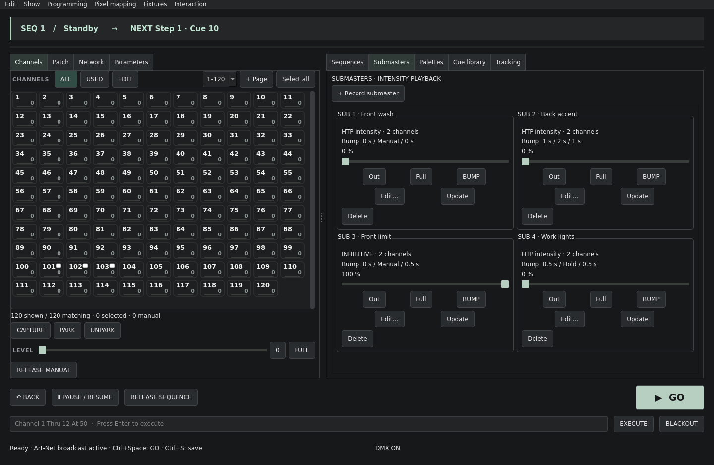

# Submaster operation

Try [`examples/submaster-playback.cfl`](../examples/submaster-playback.cfl) for Manual flash, Timed accent, an inhibitive master and Hold work lights.



Submasters control intensity only. **Additive** contributes stored levels using HTP. **Inhibitive** scales the live intensity of its included channels, including manual intensity. It generates no levels itself. Inhibitive mode uses channel membership, so the level column is hidden in its editor. Color, position and other parameters remain independent.

Use **Edit…** on a card to set its mode, membership and bump timing. Save applies the definition; Cancel leaves it unchanged. Changing mode returns that submaster to its new home position: Out for additive, Full for inhibitive. Editing timing cancels its current bump at the current level. Full and Out explicitly set a level and cancel timing.

## Bump timing

The **BUMP** button runs **Up**, then **Dwell**, then **Down**:

- **Manual**: hold the button to maintain the look; release starts Down, including when released during Up.
- **Hold**: press once to start; press again to start Down.
- **Timed**: one press runs Up, the specified dwell duration, then Down automatically.

Up moves from the current level to the target: Full for additive, Out for inhibitive. Down returns to home. Times are in seconds and support the same numeric dragging as other editors. Default timing is zero Up, Manual dwell, zero Down, giving an immediate flash. A zero-duration Timed cycle finishes immediately.

Moving the slider cancels the bump and takes direct control. Each card shows the live percentage and bump phase. Losing application focus or rebuilding the bank releases held Manual bumps so a disappearing button cannot leave a momentary flash latched. Hold and Timed playbacks continue. Show-definition Undo preserves ongoing bumps when their mode and timing are unchanged; restoring different timing cancels the bump without rewinding its level. Restoring another mode returns to that mode's home.

## Inhibitive output

An inhibitive submaster at 50% scales included intensity to half its underlying value. An **I** appears on affected channel tiles, with the submaster number and level available in footer help. Park overrides inhibition, grandmaster and blackout. Capture retains the underlying intensity so engaging Capture does not apply the inhibition twice.

When several inhibitors include a channel, Cold Flame applies the lowest fader once. The grandmaster then scales the result. This overlap rule is explicit Cold Flame behavior; it has not been compared with all Eos priority and exclusion configurations. Eos priority, shielded and exclusion options are not implemented.

Cue recordings capture the inhibited stage intensity before the grandmaster; inhibition remains active during subsequent playback. A manual intensity reference whose level has been inhibited is recorded as an absolute snapshot. Submaster Update temporarily removes that submaster's own contribution or inhibition when sampling the look.

## Keyboard commands

Commands address the displayed submaster number, which remains stable after deletion of other submasters:

```
Sub 7 At 50
Sub 7 Full
Sub 7 Out
Sub 7 Home
Sub 7 Bump
Sub 7 Release
```

`Bump` is the button-down edge; `Release` is the button-up edge. A second Hold press therefore follows a Release. These commands are a Cold Flame subset, not the complete Eos command grammar.

## Saved state and references

Show format 5 stores mode, membership and timing. It loads formats 1–4 with additive/Manual/zero-time defaults. Active bump transport and fader positions are not saved: loading puts additive subs at Out and inhibitive subs at Full. Earlier application versions cannot open format 5.

Official Eos references:

- [Submaster properties](https://www.etcconnect.com/WebDocs/Controls/EosFamilyOnlineHelp/en/Content/15_Submasters/Submaster_Properties.htm)
- [Bump button timing](https://www.etcconnect.com/WebDocs/Controls/EosFamilyOnlineHelp/en/Content/16_Submasters/Bump_Button_Timing.htm)
- [Inhibitive versus shielded](https://support.etcconnect.com/ETC/Consoles/Eos_Family/Software_and_Programming/Is_There_a_Difference_Between_a_Shielded_Fader_and_a_Inhibitive_Fader%3F)

These references informed mode, home/target, timing and override behavior. Effect and attribute submasters, priorities, exclusions, intensity-master marking and arbitrary hardware button configuration remain incomplete.
